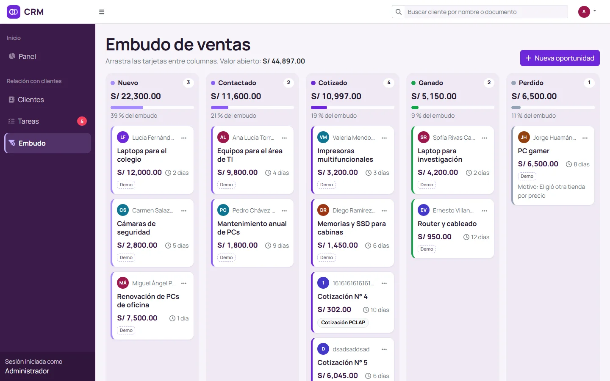
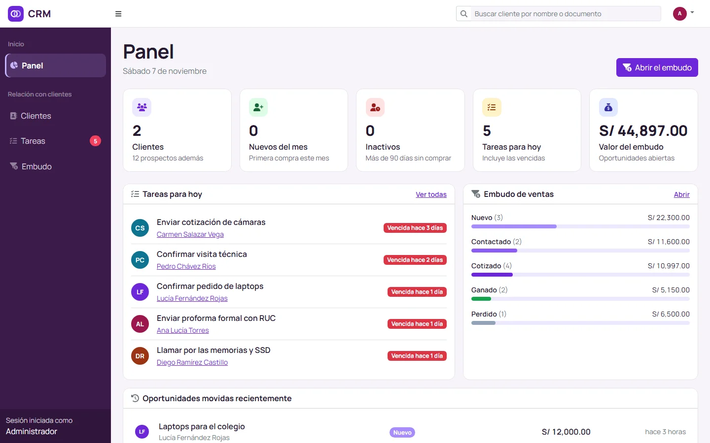
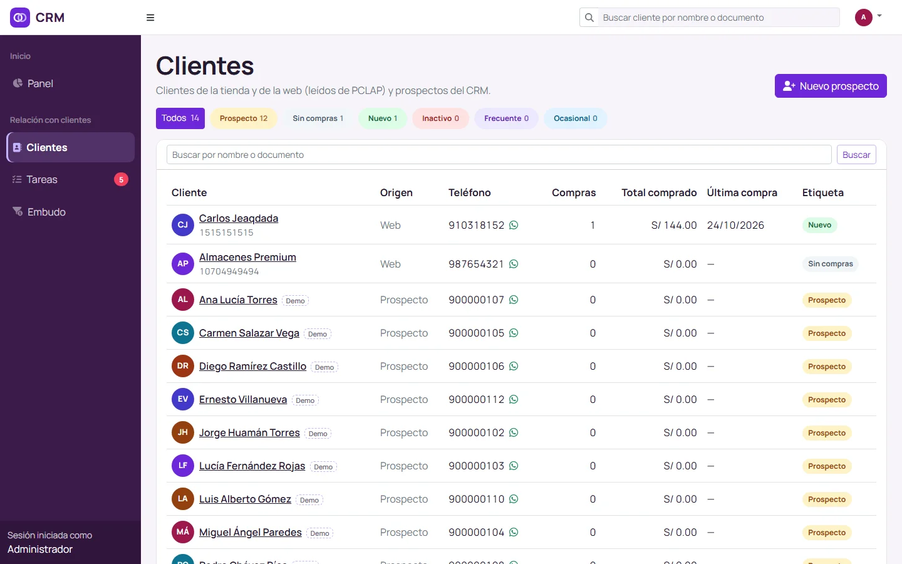
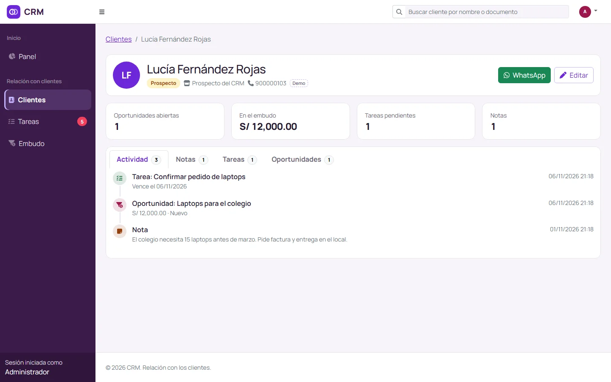
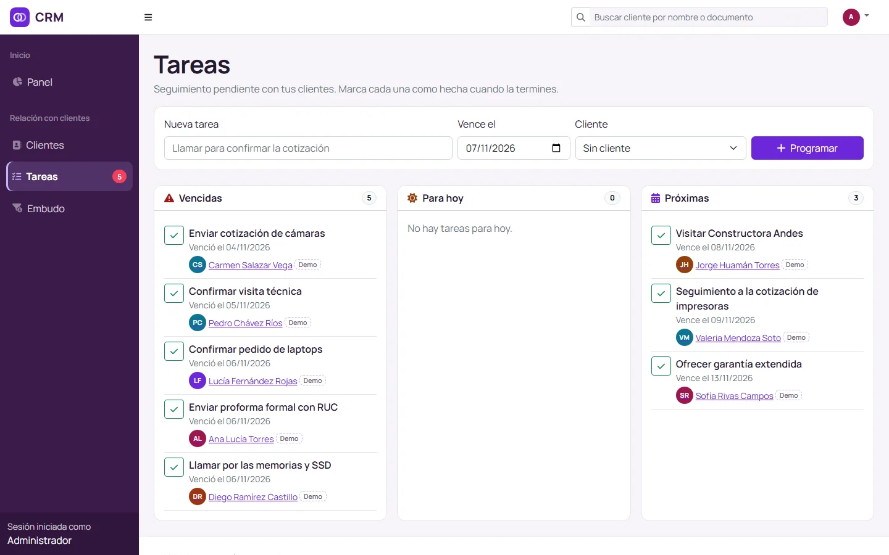

# PCLAP CRM

Sistema para gestionar la relación con los clientes de PCLAP SUPPORT, mi tienda de hardware en Lima. Junta en un solo lugar a los clientes que ya compraron y a los prospectos, organiza el seguimiento con tareas y muestra las oportunidades de venta en un embudo que se ordena arrastrando tarjetas.

Es uno de los tres sistemas de mi ERP:

| Sistema | Qué cubre |
|---|---|
| [PCLAP SUPPORT](https://www.pclap-support.com) | Ventas, compras, inventario y tienda web. En producción. |
| [PCLAP Finanzas](https://github.com/NovoaaMaster/pclap-finanzas) | Facturación electrónica con SUNAT (entorno de pruebas). |
| **PCLAP CRM** | Este repositorio: clientes, seguimiento y embudo de ventas. |



## Qué hace

- **Directorio de clientes.** Lee los clientes de la tienda y de la web desde la base de PCLAP y los muestra junto a los prospectos del CRM. Cada uno recibe una etiqueta automática:

  | Etiqueta | Cuándo |
  |---|---|
  | Prospecto | Registrado en el CRM, todavía no es cliente de PCLAP |
  | Sin compras | Cliente de PCLAP sin ventas |
  | Nuevo | Su primera compra fue en los últimos 30 días |
  | Inactivo | Lleva más de 90 días sin comprar |
  | Frecuente | Tiene 3 compras o más |
  | Ocasional | Todos los demás |

- **Ficha del cliente.** Compras, garantías, pedidos web, notas, tareas y oportunidades en una sola línea de tiempo, con un botón para escribirle por WhatsApp.
- **Tareas de seguimiento.** Separadas en vencidas, para hoy y próximas. El menú avisa cuántas están vencidas.
- **Embudo de ventas.** Cinco etapas: Nuevo, Contactado, Cotizado, Ganado y Perdido. Las tarjetas se arrastran entre columnas y, al pasar a Perdido, el sistema pide el motivo. Las cotizaciones hechas en PCLAP entran solas a la columna Cotizado.

## Capturas

| | |
|---|---|
|  |  |
| Panel con las tareas del día, los clientes y el valor del embudo | Clientes de PCLAP y prospectos, con filtro por etiqueta |
|  |  |
| Ficha de un cliente con toda su actividad | Tareas vencidas, para hoy y próximas |

## PCLAP se lee, nunca se modifica

PCLAP SUPPORT está en producción, así que el CRM lo trata como solo lectura en dos niveles:

1. Se conecta con un usuario de MySQL que solo tiene permiso `SELECT` sobre la base de PCLAP.
2. Los modelos de PCLAP (`app/Pclap/`) lanzan una excepción si algo intenta guardar o borrar.

Lo propio del CRM (prospectos, notas, tareas y oportunidades) se guarda en su propia base, `dbcrm`.

## Tecnologías

- Laravel 12 y PHP 8.2, con MySQL
- Blade, Bootstrap 5 y jQuery; SortableJS para arrastrar las tarjetas del embudo
- PHPUnit para las pruebas

## Cómo ejecutarlo

Necesitas PHP 8.2 o superior, Composer y MySQL (o MariaDB).

```bash
git clone https://github.com/NovoaaMaster/pclap-crm.git
cd pclap-crm
composer install
cp .env.example .env
php artisan key:generate
```

En `.env` completa tres cosas: la base del CRM (`DB_*`), la conexión de solo lectura a PCLAP (`PCLAP_DB_*`) y el usuario administrador (`CRM_ADMIN_EMAIL` y `CRM_ADMIN_PASSWORD`). Después:

```bash
php artisan migrate --seed       # tablas, usuario administrador y datos de demostración
php artisan serve --port=8002    # abre http://127.0.0.1:8002
```

Los datos de demostración usan fechas relativas al día en que se cargan. Para renovarlos: `php artisan db:seed --class=DemoSeeder`.

La base de PCLAP es privada. Para comprobar el sistema sin ella, corre las pruebas, que simulan PCLAP en SQLite en memoria:

```bash
php artisan test
```
